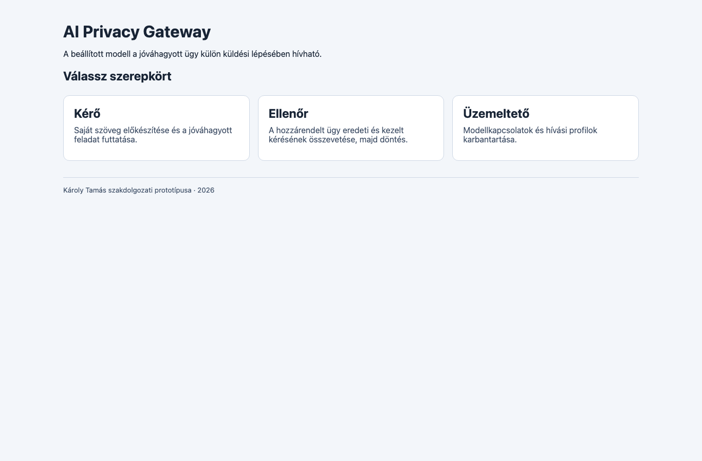

# AI Privacy Gateway A-0.3.0 — felhasználói útmutató

Az alkalmazás szakdolgozati prototípus. A helyi próba szintetikus adatokkal API-kulcs nélkül működik. A külső modell kipróbálásához saját szolgáltatói hozzáférés kell. Az első telepítés pontos lépései a [Windows telepítési útmutatóban](TELEPITES_WINDOWS.md) vannak.

## A kezdőlap és a három szerep

A `http://127.0.0.1:8765/` címen válassz szerepet. A csempén még nincs jelszó; a belépőoldalon a bemutató felhasználónév és jelszó előre kitöltött. Nyomd meg a **Belépés** gombot. A **Kilépés** visszavisz a csempékhez. Ha a Kérő és az Ellenőr egyszerre dolgozik, nyisd meg őket két külön böngészőprofilban vagy egyiküket privát ablakban.

| Szerep | Feladat |
|---|---|
| Kérő | Szöveg és modellnek szóló kérés megadása, érzékeny részek kijelölése, ügy indítása, jóváhagyás utáni küldés, válasz megtekintése. |
| Ellenőr | A hozzá kerülő ügy eredeti és kezelt tartalmának összevetése, jóváhagyás vagy visszaadás. |
| Üzemeltető | Modellkapcsolatok és hívási profilok kezelése, opcionális magyar névfelismerő telepítése. |

A fejléc menüjében a szerephez tartozó oldalak és a **Kilépés** gomb található. Egy gomb fölé állva rövid súgó jelenhet meg.

## Első használat kulcs nélkül

1. A `Start-Windows.cmd` fájllal indítsd a helyi bemutatót, és lépj be **Kérőként**.
2. A **Szintetikus példák** menüben válassz egy példát. A kiválasztott példa szövege, érzékeny részei és elvárt eredménye az oldalon olvasható. Az aktív feldolgozási minták előkészíthetők; a további minták mérési és szemléltetési anyagok.
3. A **Minta előkészítése** gomb a kijelölésszerkesztőhöz visz. A színek jelentése: személy, e-mail-cím, egyéb érzékeny adat. A javasolt kijelölések itt módosíthatók. A modell nélküli mintánál a folyamat helyi választ ad.
4. Válaszd a **Tokenizálás** kezelési módot, majd nézd meg a **Kezelt előnézetet**. A token a helyi megfeleltetéssel visszaállítható az eredeti értékre; a **Maszkolás** másik, egyszerűbb kezelési mód.
5. Az **Ügy előkészítése megerősítésre** vagy az **Ügy átadása az ellenőrnek** gomb ügyet hoz létre. Egyik sem hív külső szolgáltatót. A következő szerep a **Munkakosárban** látja a feladatot.
6. A megfelelő szerep a kezelt ügyoldalon **Megerősítés** vagy **Jóváhagyás** gombbal dönt. Csak ezt követően jelenik meg a Kérőnek a külön futtatási vagy küldési gomb.

## Üzemeltető: külső modell beállítása

Ezt a `Start-OpenAI-Windows.cmd` indítóval futó példányban végezd el. A helyi demó kulcsmentése le van tiltva. Az OpenAI csak egy előre beállított példa a támogatott külső kapcsolatokra. Saját API-kulcs és a választott modellhez hozzáférés szükséges; a modellhívás költséges lehet. A kulcsot kizárólag a helyi Üzemeltető oldalon írd be.

1. A kezdőlapon nyisd meg az **Üzemeltető** csempét, lépj be, majd válaszd a **Modellkapcsolatok** menüt.
2. Nyisd meg az **Új modellkapcsolat** blokkot. Adj nevet, válaszd az `openai-responses` protokollt, alapcímnek írd be `https://api.openai.com/v1`, és add meg a saját fiókodban elérhető szöveges modell pontos azonosítóját. A projektazonosító üresen hagyható. Válaszd az **API-kulcs** hitelesítést, írd be a saját kulcsodat, jelöld be az **Engedélyezett konfiguráció** mezőt, majd nyomd meg a **Mentés** gombot.
3. Nyisd meg a **Hívási profilok** menüt. Előbb szükséges a modellkapcsolat. A dokumentum-összefoglaláshoz hozz létre `summary`, az e-mail-választervezethez `mail-draft` feladatú profilt. Mindegyiknél válaszd ki a kapcsolatot, adj beszédes nevet, kimeneti tokenkorlátot és időkorlátot. Első próbán a `Temperature` és `Top-p` üresen maradhat; a kimeneti forma **Szöveg**. A két profilt külön mentsd.
4. A mentett kapcsolat és profil később ugyanitt módosítható vagy törölhető. A kulcs értékét a felület nem jeleníti meg újra. Kulcscseréhez írj be új kulcsot és mentsd a kapcsolatot.

Ha a Kérőnél nem választható modellprofil, ellenőrizd az indítót, a kapcsolat **Engedélyezett** állapotát és a feladathoz illő mentett profilt. A mentés önmagában nem indít modellhívást.

## Üzemeltető: magyar névfelismerő

A **Névfelismerő telepítése** menüben a letöltés külön jóváhagyható. A helyi `hu_core_news_md` modell személynév-javaslatokat készít. Telepítés előtt jelöld be a jóváhagyó négyzetet, majd nyomd meg a **Telepítés indítása** gombot; a letöltés idején hagyd nyitva a kiszolgálót. Ugyanitt látható a modell és a futtató verziója, valamint az állapot. A modell ki- és bekapcsolható, újratelepíthető vagy eltávolítható. A Kérő **Névfelismerő állapota** menüje tájékoztat; telepítést az Üzemeltető végez.

A névfelismerő javasol, a döntést a Kérő hozza meg. Bármely szövegrész kézzel is érzékenynek jelölhető, akkor is, ha a modell nem találta meg.

## Kérő: saját szöveg vagy dokumentum

1. A **Saját szöveg** menüben válassz **Dokumentum-összefoglalás** vagy **E-mail-választervezet** feladatot. A **Forrás** mezőbe másold a feldolgozandó szöveget, a **Kérés** mezőbe írd le pontosan, mit kérsz a modelltől. A kettőt külön kezeli a rendszer.
2. Ha fájlt használnál, nyisd ki a **Forrás feltöltése fájlból** részt. UTF-8 `.txt` vagy egyszerű `.docx` tölthető fel, legfeljebb 1 MiB méretben és 8000 kinyert karakterrel. A szöveges előnézetet ellenőrizd; az eredeti fájl nem kerül a modellhez. PDF, képek és beágyazott DOCX-objektumok feldolgozását ez a verzió nem vállalja.
3. A **Tovább a kijelöléshez** gomb megnyitja a forrást és a kérést. A szövegben jelölj ki egy szakaszt, válassz kategóriát (**Személy**, **E-mail**, **Egyéb érzékeny**), majd nyomd meg a **Kijelölés hozzáadása** gombot. A jelöléseket a listában ellenőrizheted és törölheted. A **Nagy előnézet** hosszabb szöveghez görgethető ablakot ad.
4. Ha egy kijelölt értéket később is fel szeretnél ismertetni, a kijelölésnél használd a külön **Megjegyzés későbbre** műveletet. A puszta kijelölés az aktuális ügy része; az értéktárba külön mentés szükséges. A **Mentett érzékeny elemek** menüben kereshetsz, módosíthatsz és törölhetsz mentett értékeket.
5. Válaszd a **Tokenizálás** vagy **Maszkolás** módot, majd nyomd meg a **Kezelt előnézet megtekintése** gombot. Ez helyi ellenőrzés, és a piszkozat szerkeszthető marad.
6. A modellképes példányban válassz a feladatnak megfelelő **Modellprofilt**. Az **Ügy átadása az ellenőrnek** vagy **Ügy előkészítése megerősítésre** gomb után az ügyoldalon látszik a státusz és a következő felelős. A **Piszkozat mentése a munkakosárba** gombbal később folytathatod.

Valódi személyes vagy üzleti titkot csak akkor adj meg, ha vállalod annak helyi tárolását és a szolgáltatói küldés feltételeit. Bírálói próbához a szintetikus minták ajánlottak.

## Munkakosár és ellenőri döntés

A **Munkakosár** a piszkozatokat és az összes létrehozott ügyet mutatja, státusszal és következő felelőssel. Kereséssel és szűréssel szűkíthető. Az ügy nem tűnik el attól, hogy más szerepnél van a feladat; a korábbi ügyek is megtekinthetők. A szerver újraindítása után a helyi adatbázisban tárolt ügyek folytathatók, amíg ugyanazt a kicsomagolt mappát használod.

Ha az ügy **Ellenőrre vár**, az Ellenőr a saját munkakosarában nyissa meg. Az ügyoldalon megjelenik az eredeti szöveg a színes érzékeny jelölésekkel, a Kérő pontos feladata, a kezelt előnézet és a szolgáltatónak szánt kérés pontos törzse. Az Ellenőr **Jóváhagyás** vagy **Visszaadás javításra** gombbal dönt. Az Ellenőr nem indít külső hívást. A Kérő később a saját munkakosarából folytatja.

A jóváhagyás a látható kezelt tartalomra érvényes. Ha ez változik vagy a jóváhagyás lejár, új ellenőrzés kell. A küldés előtt mindig a **szolgáltatónak szánt kérést** nézd át, mert ez a külső hívás tényleges tartalma.

## Küldés és válasz

A Kérő jóváhagyott ügyén jelenik meg a **Küldés a szolgáltatóhoz** gomb. Ez indítja a külső HTTPS-kérést a kiválasztott profil szerint. A kulcs hitelesítési fejlécben megy a szolgáltatóhoz; nem része a szövegtörzsnek. A válaszoldalon együtt nézhető meg az eredeti szöveg érzékeny jelölésekkel, a pontosan kért feladat, az elküldött kezelt kérés és a modell válasza. A tokenek helyi visszaállítását a helyi megfeleltetés segíti. Ellenőrizd a válasz tartalmát, mert a modell tévedhet.

Ha a modell helyett a helyi demót indítottad, a gomb **Helyi futtatás** vagy **Helyi kapupróba** feliratú lehet, és nincs külső hívás.

## Hiba és adatkezelés

Ha egy gomb után hibaképernyő nyílik, lépj vissza a szerep **Munkakosarába**, és nézd meg az ügy státuszát. Lejárt munkamenetnél jelentkezz be újra; a mentett ügyet az adatbázis őrzi. Külső hiba esetén ellenőrizd az internetet, az API-kulcs érvényességét, a modellazonosítót és a szolgáltatói hozzáférést. A kulcsot ne másold hibajegybe vagy képernyőképbe.

A telepítési mappa `.local` alkönyvtárában helyi ügyek, érzékeny értékek és esetleg API-kulcs vannak. Ne küldd tovább és ne töltsd fel GitHubra. A program helyi ügytára nem alkalmazásszinten titkosított. Az eltávolítás és frissítés lépéseit a [telepítési útmutató](TELEPITES_WINDOWS.md) tartalmazza.
